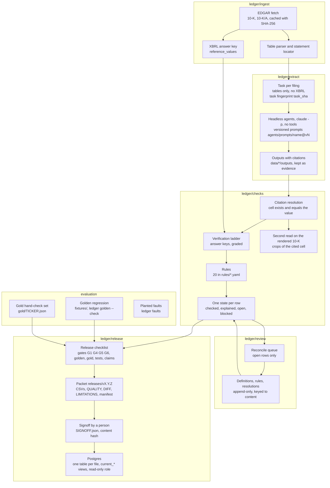

# Capex Ledger

An auditable pipeline that turns SEC 10-K filings into a versioned dataset of revenue, capex, opex, note-level facts
(segment capex and revenue, PP&E by category, finance leases, purchase commitments) and company statements about AI
spend. Agents read the filings; deterministic code checks every number against the cell it cites and against
independent answer keys; a person reviews only what code cannot decide and signs each release. Every figure in a release
carries its citation, its verification level and the record that verification rests on.

Coverage: six companies proven end to end (`config.PROVEN`: MSFT, GOOGL, AMZN, NVDA, APLD, AMD), 100 tracked
(`docs/COMPANIES.md`), fiscal years 2022 to 2026, annual.

The web app, Kenny's Data Emporium (`ledger app`, port 3610), shows every row's state, the review queue, the release
checklist and these docs.

## Architecture



The stages, with the module that owns each (full map: [docs/MAP.md](docs/MAP.md)):

1. **Fetch** (`ledger/ingest/edgar.py`). 10-Ks from FY2022 on, cached by SHA-256. `LEDGER_OFFLINE=1` serves every read
   from the cache and refuses anything uncached.
2. **Locate** (`ledger/ingest/tables.py`, `statements.py`). HTML tables parsed into cells; income, cash-flow and note
   tables located. The filer's XBRL facts become the answer key (`reference_values`), never shown to a reader.
3. **Extract** (`ledger/extract/`). One task per filing per reader. Five live agents, each with a charter in
   `agents/charters/`: statements (`statements@v2`), notes (`notes@v3`), AI statements (`aispend@v4`), projects
   (`projects@v1`) and the asset-type mapper (`mapper@v1`). They run headless on a subscription (`claude -p`, no tools),
   answer in JSON against a schema (`agents/schemas/`), get one retry with the reason, then a logged failure. Every run
   records model, tokens, seconds, attempts and the task's SHA-256 (`runs`). An output loads only if it answered the
   current task.
4. **Resolve citations** (`ledger/extract/extract.py`, rule `citation_resolves`). Every value names table, row, column
   and cell; the cell must exist in the parsed filing and equal the value with its unit and sign rule. Quotes must
   match their source text after normalisation.
5. **Verify** (`ledger/checks/`, `ledger/core/status.py`). The answer keys, the rules, and a second read of every cited
   cell on the 10-K rendered in Chrome (`ledger/checks/crops.py`). One function, `status.state`, gives every row one of
   four states, and every page and gate reads it.
6. **Review** (`ledger/review/`, the Reconcile page). Only open rows reach a person, each with the reason code could
   not decide it. A decision is a definition (`definitions/companies.yaml`), a rule (`rules/`), or a resolution
   (`decisions/resolutions.jsonl`) keyed to a hash of the item's content, so it lapses when its inputs change.
7. **Evaluate** (`ledger/checks/golden.py`, `ledger/review/gold.py`, `ledger/checks/faults.py`). Below.
8. **Release** (`ledger/release/`). The checklist gates the packet; a person signs its content hash; `publish` writes
   it to Postgres.

## Verification ladder

A checked row names the strongest independent record that agrees with it. Strongest first
(`status.KEY_GRADE`, `ties.fact_state`, words from `ledger/core/states.py`):

| Rung | Page word | Proves | Does not prove |
|---|---|---|---|
| Twin XBRL match (`xbrl`) | Verified | The number read from the document is the number the filer tagged for the same concept and period, to the unit and sign. The reader never saw the tag. | That the filer is right. XBRL and the 10-K come from the same company, so an error made in both passes. |
| Tie to a tagged total (`rule:<id>_tie`) | Corroborated | The parts one filing prints sum to the total the same filing tags, within (n + 1) × half the coarsest rounding unit. | That any one part is right. Two misreads that offset inside the bound still tie. |
| Second reading (`reading:<accession>`) | Corroborated | Two or more of the filer's 10-Ks print the same figure within half a rounding unit, so it is not one reader's one-off misread. | Anything upstream of the table: it is usually the same preparer's table carried forward and read by the same reader. |
| Company tag (`mapping:filer_tag`) | Matches company tag | A reported PP&E category's us-gaap member is the one the company's own XBRL uses for it. | That the amount is right; this is a classification check. |
| Citation only (`label:no_reference`) | Unverified | The cited cell exists and holds the value. | Anything beyond the citation: no tag, no tie, one reading. |

A label never counts as a check: every checked or explained row must point at the record it rests on, and a walk over
the proven set fails on any that does not (`status.evidence_gap`, `proof.unevidenced`). On the six, rows by strongest
key: twin 273 of 889, tie 101, second reading 17, no key 498 (golden fixtures; [docs/PROOF.md](docs/PROOF.md)). Second
source and later truth are declared keys that no row carries yet.

## Evaluation

No model grades another model. Every check is deterministic code, so a score reruns to the same result.
Detail: [docs/EVALS.md](docs/EVALS.md).

- **Golden regression** (`ledger golden --check`). Rebuilds the proven six from frozen inputs (`fixtures/`: parsed
  tables, texts, the agents' answers) in a temporary folder with nothing fetched and no agent asked, and compares every
  table column by column. Agents are frozen on purpose: their answers are inputs, the checks on them are under test.
  Equal tables mean nothing changed, not that anything is right. Last run: tables equal (`reports/golden.json`).
- **Gold set** (`gold/<TICKER>.json`, `ledger gold`). Per proven company 10 values and 10 facts, stratified by field and
  year, untagged facts oversampled to 6 of 10, drawn with a per-release seed. A person gives each a verdict against the
  filing: right, wrong or can't say. Error rate is wrong of (right + wrong) with a Wilson 95% interval
  (`ledger/core/stats.py`). Current state, from `gold/*.json` and `reports/golden.json`: 50 of 120 items verified, 50
  right, 0 wrong; error rate 0 of 50, interval 0–7.1%. By group: values 0 of 29 (0–11.7%), facts 0 of 21 (0–15.5%),
  facts with no XBRL tag 0 of 11 (0–25.9%). 70 items are unverified, so the Golden line on the Release page is red
  until they are given.
- **Planted faults** (`ledger faults`). Real extractions corrupted one at a time in nine ways (wrong column, stale
  column, wrong row, scale, sign, digits, omission, wrong table, systematic). Stage 3 run
  (`reports/stage3-faults.json`): 31,206 planted, 29,258 caught by a rule, 131 caught only by XBRL, 1,805 no effect on a
  released value, 12 escaped. With XBRL off (`reports/stage3-faults-xbrl-off.json`): 143 escaped. Planted kinds are not
  the real error mix; the catch rate bounds what the checks can see.
- **Per-agent scores** (`ledger/checks/score.py`, Rules page). Each reader's outputs counted checked, explained, open and
  blocked, agreement with its twin where one exists, with denominators and a Wilson interval.
- **Tests.** `ledger test` runs the suite offline and writes `reports/tests.json`, which the Release page reads
  (last recorded run: 661 tests, 0 failing, 1 skipped).

## Data model

DuckDB in development (`data/ledger.duckdb`, schema in `ledger/core/store.py`), Postgres for signed releases. Full
column reference: [docs/DATA_DICTIONARY.md](docs/DATA_DICTIONARY.md).

| Table | Grain | Holds |
|---|---|---|
| `documents` | filing | accession, form, dates, SHA-256, parser version, the located statement tables |
| `reference_values` | XBRL fact | the answer key: concept, period, value, from the filer's instance |
| `extractions` | cited cell | the statements reader's value with table, row, column, cell |
| `values` | company × field × fiscal year | revenue, capex, opex with basis, first-reported figure and reconcile label |
| `note_extractions`, `facts` | cited cell, fact | note figures per filing, and per fact across filings |
| `texts`, `ai_statements`, `ai_spend` | text, quote | MD&A, 8-K releases, transcripts; verbatim AI-spend statements |
| `projects` | named project | data centers, fabs, power, commitments, with quotes |
| `rules`, `exceptions` | rule, firing | the rule registry with file hashes; every firing on a row |
| `decisions`, `runs` | decision, agent call | review decisions; model, tokens, seconds, attempts, task hash |

The release's `taxonomy` list gives one row shape for spent, committed, derived, planned and company-stated AI figures,
every category a named standard's concept, built by code ([docs/TAXONOMY.md](docs/TAXONOMY.md)). The read API
(`/api/v1/`, [docs/API.md](docs/API.md)) serves every list as JSON or CSV, with `?as_of=YYYY-MM-DD` for point-in-time
reads from filing dates.

## Releases and contracts

- **Gates** (`ledger/release/release.py`, per company): G1 every filing read with no failure open; G4 no block without a
  decision; G5 every value XBRL cannot vouch for confirmed on the rendered filing; G6 no run decision or asset-type
  mapping without a person's confirmation.
- **Checklist** (`ledger/release/checklist.py`, the Release page): the gates plus open and blocked items, answer-key
  values missing from the dataset, unmapped asset types, the golden test and gold set, the test run on the signed
  commit, the claims register and the previous releases' hashes. Signing is enabled only when every required line is
  green.
- **Packet** (`releases/vX.Y.Z/`): `values.csv`, `facts.csv`, `statements.csv`, `ai_spend.csv`, `projects.csv`,
  `taxonomy.csv`, `companies.csv`, `README.md`, `QUALITY.md` (what a person checked), `DIFF.md` (against the previous
  version), `LIMITATIONS.md` (from `taxonomy/limitations.yaml`, from the next release on) and `manifest.json` (prompt,
  parser, model, rule file hashes). Files are LF, hashed before writing and read back byte-exact; the same inputs give
  the same hash.
- **Signoff** (`SIGNOFF.json`): signer, time, hash and the checklist as it stood. A person signs; agents never do.
  Latest: v1.8.0, 71 values, 327 facts, 617 taxonomy rows, 227 statements, 182 projects, signed by Kenny Geiler
  (`releases/v1.8.0/SIGNOFF.json`).
- **Production** (`ledger/release/publish.py`): Postgres, one table per release file plus `ledger_releases`; every row
  carries its release version, and `current_*` views follow the highest published version. Consumers get the
  read-only `DATABASE_READONLY_URL` role, SELECT only.
- **Claims register** (`claims/claims.yaml`, `claims/findings.jsonl`, `ledger claims`): every claim a page, the API or a
  release makes, with the functions and tests that back it and a computed status; generated view in
  [docs/CLAIMS.md](docs/CLAIMS.md), live on the Known gaps page.

## Known limitations

From `taxonomy/limitations.yaml`, `docs/CLAIMS.md` and [docs/HANDOFF.md](docs/HANDOFF.md):

- **Same-filer answer key.** XBRL and the 10-K are both the company's; agreement is an independent reading of one
  source, not independent sources.
- **Ties bound sums, not parts.** Two offsetting misreads inside the tolerance still tie.
- **Second readings share pedigree.** A repeated misreading of a carried-forward table agrees with itself.
- **Without a structured twin, systematic errors escape.** With XBRL off, 143 planted faults escaped (above); sources
  without tags (ESEF without tags, KPI tables, transcripts) are exposed.
- **Omissions.** Some planted omissions escape every check.
- **Gold is incomplete.** 70 of 120 items have no verdict; the error-rate interval is wide.
- **One person.** The same person builds, reviews and signs; there is no second reviewer and no sign-in (the name in the
  signer box is a claim, checked against `config.PEOPLE`).
- **Interpretive fields unmeasured.** For AI statements and projects only the quote is checked, not what the reader
  concluded from it.
- **Asset-type mappings.** Agent proposals until a person confirms each or the company's own tag matches; unconfirmed
  ones fail G6.
- **Outside the proven set** numbers are not proven and not released.
- **Survivor bias.** The universe is today's AI-relevant names.
- **Older vintages** in point-in-time reads are not checked against their own XBRL.
- **No monitoring thresholds.** No floor on twin agreement or fault catch rate stops a release.
- **Stale inputs.** The EDGAR check is manual (`ledger watch`), and the hosted read-only copy has no deploy record.

## Quickstart

```bash
uv sync                                                        # Python 3.12, DuckDB, edgartools, pypdf, playwright
echo 'SEC_USER_AGENT="Your Name you@example.com"' > .env        # the SEC requires a contact; never commit .env
uv run python -m ledger test --fast                            # whole suite offline; writes reports/tests.json
uv run python -m ledger run --ticker NVDA                      # every step for one company, agents included
uv run python -m ledger app                                    # http://127.0.0.1:3610
```

The agents run on a Claude subscription, headless: run `claude`, `/login`, then `export LEDGER_CLAUDE="$(which claude)"`.
Without it every code stage still runs on the stored agent outputs. To add a company: `ledger run --ticker X`, give it an
industry in `ledger/core/config.py` `INDUSTRIES`, map its asset types (`ledger mapper X`) and review it on Reconcile.
Release, review and grading routines: [docs/OPERATIONS.md](docs/OPERATIONS.md).

## Repository map

Where everything lives and what to edit for a change: [docs/MAP.md](docs/MAP.md). How the system fits together:
[docs/OVERVIEW.md](docs/OVERVIEW.md). Taking it over: [docs/HANDOFF.md](docs/HANDOFF.md). How a change is built:
[docs/BUILD.md](docs/BUILD.md). Every state machine and its page words: [docs/STATES.md](docs/STATES.md).
