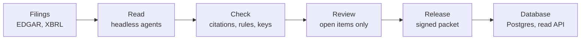

# How it works

The Capex Ledger turns SEC 10-K filings into a versioned dataset of revenue, capex, opex and the notes behind them. Every
figure carries the cell it came from and its verification level: the strongest check that agrees with it (the filer's
own XBRL, a tie to a tagged total, a second reading), or "citation only" when there is none, which is the case for more
than half the rows in scope. Agents read; code checks; a person decides only what code cannot, and signs each release.

| Step | What happens | Page | Package ([Map](MAP.md)) |
|---|---|---|---|
| Filings | Each 10-K from FY2022 on is fetched from EDGAR and cached with its SHA-256; tables are parsed and the statements located; the company's XBRL facts become the answer key in `reference_values`. Nothing is fetched in offline mode. | [Proof](#proof) | [ledger/ingest/](../ledger/ingest/) |
| Read | One task per filing goes to a headless agent (`claude -p`, no tools) with a versioned prompt. The task holds the tables only, never the answer key. Every number comes back with its table, row, column and cell. An output loads only if it answered the current task (its fingerprint). | [Rules](#rules) | [ledger/extract/](../ledger/extract/) |
| Check | Code resolves every citation to its cell, runs the rules, compares with the answer keys where one exists (XBRL twin, tie to the tagged total, second reading, company tag) and, for the six in scope, re-reads each cited cell on the rendered filing. Each row lands in one state: checked, explained, open or blocked. | [Proof](#proof) | [ledger/checks/](../ledger/checks/) |
| Review | A person sees only open rows, each with its evidence and the reason code could not decide it, and closes it with a definition, a rule or a resolution. A decision holds only while its inputs are unchanged. | [Reconcile](#reconcile) | [ledger/review/](../ledger/review/) |
| Release | The Release checklist reads every gate, the golden test, the gold set, the test run and the claims register. When every required line is green, a person signs the content hash. Same inputs, same hash. | [Release](#release) | [ledger/release/](../ledger/release/) |
| Database | A signed release is published to Postgres, one table per release file and `current_*` views; consumers get a read-only role. The app's read API serves the same lists, with point-in-time queries. | [Dataset](#data) | [ledger/release/](../ledger/release/), [ledger/web/](../ledger/web/) |

## What each figure carries

| Field | Meaning |
|---|---|
| value | The number as reported, in dollars, with its sign rule applied |
| citation | Accession, table, row label, column header and cell; for the six in scope, a crop of the cell on the rendered filing (written by `ledger evidence --crops`, not kept in git) |
| state | Checked, explained, open or blocked, from one function (`status.state` in `ledger/core/status.py`) that Proof, Reconcile, the trail and the gates read |
| by | What the state rests on: `xbrl`, `rule:<id>_tie`, `reading:<accession>`, `mapping:filer_tag`, `quote`, `definition:<name>`, `resolution:<id>`, `label:<label>` |
| word | The row's word on the trail, Reconcile and Proof, from [the state machines](STATES.md): Verified, Corroborated, Matches company tag, Unverified, Needs review, Blocks release |

## How correctness is measured

- **Golden regression.** `ledger golden --check` rebuilds the proven set from frozen inputs and compares every table. It proves nothing changed, not that anything is right. See [Evaluation](EVALS.md).
- **Gold set.** A stratified sample per proven company, each item checked against the filing by a person. Error rate with n and a Wilson 95% interval.
- **Planted faults.** Real extractions corrupted one way at a time; the report says what caught each.
- **Claims register.** Every claim a page makes, with what backs it and a computed status. What is not yet true is in [Known limitations](CLAIMS.md).

## Where to go next

- Run it, review it, release it: [Operating guide](OPERATIONS.md).
- The words on the pages: [Glossary](#docs/glossary).
- Every rule and gate: [Rules and checks](#docs/rules).
- Where the code lives: [Map](MAP.md). Taking the system over: [Handoff](HANDOFF.md).
